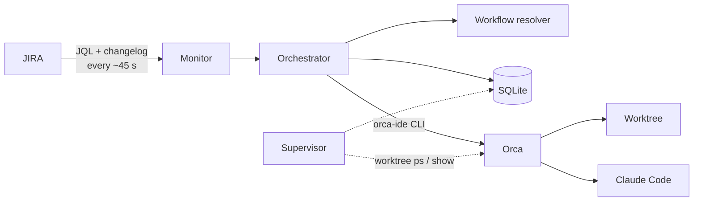

<h1 align="center">🐋 spyhop</h1>

<p align="center">
  <strong>Turn JIRA tickets into Claude Code agents running in Orca.</strong><br/>
  A small local daemon that watches your tickets and starts the work when you do.
</p>

<p align="center">
  
  
  
  
</p>

---

*Spyhopping* is when an orca lifts its head out of the water to look around.
Spyhop does the same with JIRA: it keeps an eye on your tickets and, when one of
them moves to a "start" status such as **In Progress**, it sets up the work for
a Claude Code agent in [Orca](https://www.onorca.dev).

You stay in control of what gets worked on: you assign tickets by hand and you
move them to *In Progress* yourself. Spyhop only takes over from there.

## Table of contents

- [Features](#features)
- [How it works](#how-it-works)
- [Project status](#project-status)
- [Requirements](#requirements)
- [Installation](#installation)
- [Quick start](#quick-start)
- [Configuration](#configuration)
- [Running as a service](#running-as-a-service)
- [Usage](#usage)
- [Troubleshooting](#troubleshooting)
- [Security](#security)
- [Development](#development)
- [Project layout](#project-layout)

## Features

- **Transition-based triggers.** A ticket starts an automation when it *enters*
  a start status, not every time it is seen there. Leaving and re-entering
  starts a new one.
- **Exact and idempotent detection.** JQL finds the candidates; the JIRA
  changelog gives the exact transition time and a stable id, so a transition is
  never processed twice.
- **Nothing lost while offline.** Transitions that happen while your laptop is
  off are picked up on the next successful poll.
- **Per-project, per-issue-type workflows.** Each issue type has its own start
  statuses, repository, base branch, prompt and plan-review setting.
- **Portable.** Nothing machine-specific in the code or the repository:
  configuration follows XDG, repositories are aliases, credential variable names
  are configurable.
- **Safe dry-run mode**, with its own database, to see what *would* be
  automated before anything is.
- **Runs in the background** as a systemd user service that starts at boot.
- **`spyhop doctor`** checks credentials, JIRA projects, issue types and
  statuses, repositories, Orca and the service, so a typo never fails silently.

## How it works



1. Every polling interval, Spyhop asks JIRA for **your** tickets that changed
   into a configured start status since the last successful poll.
2. For each one it reads the changelog to find the exact transition, resolves
   the workflow for that project and issue type, and records an automation run.
3. *(Coming next)* It creates an Orca worktree linked to the ticket and launches
   Claude Code with a verifiable `/goal`: first a plan for you to approve, then
   the implementation, ending with local commits and a `RESULT.md`.
4. *(Coming next)* When the ticket is closed, the worktree is removed. Orca
   deletes the branch only if it is already merged.

Spyhop never pushes, opens pull requests or changes tickets: that stays with you.

## Project status

Spyhop is being built in phases. **Only phase 1 is implemented today**: it
detects tickets and records what it would do, but it does not launch agents yet.

| Phase | Scope | State |
| --- | --- | --- |
| 1 | Configuration, JIRA detection, SQLite, `doctor`, systemd service | ✅ Done |
| 2 | Worktree creation and agent launch in Orca | ⏳ Planned |
| 3 | Agent supervision and plan review | ⏳ Planned |
| 4 | Worktree cleanup on close, `retry` and `cleanup` commands | ⏳ Planned |

## Requirements

| Requirement | Notes |
| --- | --- |
| Linux with systemd | The service runs as a systemd **user** unit. |
| Python 3.12+ | uv can provide it if your system does not. |
| [uv](https://docs.astral.sh/uv/) | Dependency management and installation. |
| [Orca](https://www.onorca.dev) with its CLI | Install the CLI from Orca's settings; on Linux it is called `orca-ide`. |
| JIRA Cloud account and API token | Create one at <https://id.atlassian.com/manage-profile/security/api-tokens>. |

> [!WARNING]
> On many Linux desktops `orca` is the **GNOME screen reader**. Spyhop never
> runs a command called `orca`: it looks for `orca-ide` and refuses any Python
> script it is pointed at.

## Installation

Install uv if you do not have it:

```sh
curl -LsSf https://astral.sh/uv/install.sh | sh
```

Install Spyhop as a command-line tool (it lands in `~/.local/bin`):

```sh
uv tool install git+https://github.com/JavierMoral/spyhop.git
spyhop version
```

## Quick start

**1. Make your JIRA credentials available in the session.** By default Spyhop
reads `JIRA_API_USER` (your Atlassian email) and `JIRA_API_TOKEN`, for example
from `~/.profile`:

```sh
export JIRA_API_USER="you@example.com"
export JIRA_API_TOKEN="your-api-token"
```

**2. Create the configuration.** This writes `~/.config/spyhop/config.yaml` from
the example and copies the credentials into `~/.config/spyhop/env` (mode 600) for
the background service. Neither file is ever overwritten.

```sh
spyhop config init
```

**3. Edit the configuration** with your JIRA site, repositories, projects and
start statuses (see [Configuration](#configuration)):

```sh
$EDITOR ~/.config/spyhop/config.yaml
```

**4. Check everything.** Fix every ✗ before going further.

```sh
spyhop doctor
```

```text
✓ configuration: /home/you/.config/spyhop/config.yaml
✓ session credentials: JIRA_API_USER, JIRA_API_TOKEN are set
✓ credentials file: /home/you/.config/spyhop/env
✓ jira: https://your-site.atlassian.net as Your Name (Europe/Madrid)
✓ project PROJ: 3 workflows match JIRA
✓ repository main: /home/you/git/your-repository
✓ orca: /home/you/.local/bin/orca-ide (version 1.4.245), runtime ready
! service: not installed; run `spyhop service install`
```

**5. Try it in the foreground,** in dry-run mode (the default):

```sh
spyhop run --once -v     # one poll; the first one only sets the starting point
spyhop run               # keep watching; Ctrl+C to stop
```

**6. Install the background service** (see [Running as a service](#running-as-a-service)):

```sh
spyhop service install
loginctl enable-linger "$USER"
```

## Configuration

Spyhop reads `~/.config/spyhop/config.yaml` (or the file given with `--config`
or `SPYHOP_CONFIG`). A complete, commented example is in
[`src/spyhop/templates/config.example.yaml`](src/spyhop/templates/config.example.yaml).

```yaml
application:
  polling_interval: 45            # seconds between polls
  dry_run: true                   # only log what would be done

jira:
  base_url: https://your-site.atlassian.net
  user_env: JIRA_API_USER         # names of the variables, never their values
  token_env: JIRA_API_TOKEN

repositories:                     # alias -> path on this machine
  main:
    path: ~/git/your-repository
    default_base_branch: master

projects:
  PROJ:
    workflows:                    # keyed by JIRA issue type
      Bug:
        name: bug_fix
        trigger_statuses: ["In Progress"]
        repository: main
        prompt: bug_fix.md
        plan_review: true
```

### Reference

| Key | Default | Description |
| --- | --- | --- |
| `application.polling_interval` | `45` | Seconds between polls (minimum 10). |
| `application.max_concurrent_agents` | `1` | Agents running at the same time. |
| `application.dry_run` | `true` | Detect and record only; uses a separate database. |
| `application.timezone` | system | Time zone for display. |
| `jira.base_url` | — | Your JIRA Cloud site. **Required.** |
| `jira.user_env` / `jira.token_env` | `JIRA_API_USER` / `JIRA_API_TOKEN` | Names of the credential variables. |
| `jira.request_timeout` | `20` | Seconds per JIRA request. |
| `jira.transition_margin_minutes` | `5` | Overlap between polls, because JQL dates work to the minute. |
| `repositories.<alias>.path` | — | Local checkout. Accepts `~` and `${VAR}`. |
| `repositories.<alias>.default_base_branch` | `master` | Base branch for new worktrees. |
| `projects.<KEY>.enabled` | `true` | Ignore a project without deleting its workflows. |
| `projects.<KEY>.workflows.<IssueType>.name` | — | Workflow name, shown in logs and `status`. |
| `….trigger_statuses` | — | Statuses that start an automation for this issue type. |
| `….repository` | — | Repository alias. |
| `….base_branch` | repository default | Overrides the repository's base branch. |
| `….prompt` | — | Prompt template for the agent. |
| `….plan_review` | `true` | Ask for your approval of the plan before implementing. |
| `orca.executable` | autodetected | Path to the Orca CLI; `orca-ide` is found in `PATH` when omitted. |
| `orca.startup_timeout` / `orca.operation_timeout` | `30` / `120` | Seconds. |
| `agents.provider` / `model` / `effort` | `claude` / `sonnet` / `high` | Agent launched in Orca. |
| `cleanup.enabled` | `true` | Remove a ticket's worktree when the ticket closes. |
| `cleanup.close_status_categories` | `["done"]` | JIRA status categories that count as closed. |
| `cleanup.close_statuses` | `[]` | Extra closed statuses outside those categories. |
| `service.env_source` | `env_file` | How the service gets credentials: `env_file` or `login_shell`. |
| `service.env_file` | `~/.config/spyhop/env` | Credentials file for `env_file`. |

### Overriding values

Precedence, lowest first: defaults → `config.yaml` → environment variables →
command-line options. Environment variables use the `SPYHOP_` prefix and `__`
between levels:

```sh
SPYHOP_APPLICATION__DRY_RUN=false spyhop run
SPYHOP_APPLICATION__POLLING_INTERVAL=120 spyhop run
```

### Files Spyhop uses

| What | Where |
| --- | --- |
| Configuration | `~/.config/spyhop/config.yaml` |
| Credentials for the service | `~/.config/spyhop/env` (`KEY="value"`, mode 600) |
| State | `~/.local/state/spyhop/spyhop.db` |
| State in dry-run mode | `~/.local/state/spyhop/spyhop-dry-run.db` |
| Service unit | `~/.config/systemd/user/spyhop.service` |

All of them follow `XDG_CONFIG_HOME` and `XDG_STATE_HOME`.

## Running as a service

```sh
spyhop service install          # writes the unit with this machine's paths and starts it
loginctl enable-linger "$USER"  # once per machine: start at boot instead of at login
spyhop doctor                   # should now report the service as active
```

Without lingering, a systemd user service only starts when you log in. The unit
restarts Spyhop 30 seconds after a failure and gives up after 5 failures in 10
minutes, for example with an invalid token; the reason is in the logs.

After a reboot:

- Spyhop starts before you log in and keeps watching JIRA. If the network is not
  ready yet, it retries without losing transitions.
- Orca is a desktop app, so it is only available once you log in. Add it to your
  session's startup applications. Until it answers, detected tickets wait.

**Credentials.** By default the service loads `~/.config/spyhop/env`, which
`spyhop config init` creates from your session. Spyhop does not read
`~/.profile` itself. If you rotate the token, update both places; `spyhop doctor`
warns when they differ, without printing either value. To use your login shell's
environment instead, set `service.env_source: login_shell` and run
`spyhop service install` again.

To remove the service:

```sh
spyhop service uninstall
```

## Usage

| Command | Description |
| --- | --- |
| `spyhop run` | Run the daemon in the foreground. `--once` polls once; `--dry-run/--no-dry-run` overrides the configuration; `-v` for debug logs. |
| `spyhop status [KEY]` | Last poll, watermark, last error and active runs. `--all` includes finished runs. |
| `spyhop doctor` | Check configuration, credentials, JIRA projects and statuses, repositories, Orca and the service. Exits with 1 if anything is wrong. |
| `spyhop config init` | Create the configuration and the credentials file if they are missing. |
| `spyhop service install` | Install, enable and (re)start the systemd user service. `--no-start` only enables it. |
| `spyhop service uninstall` | Stop, disable and remove the service. |
| `spyhop version` | Print the version. |

Follow the service logs:

```sh
journalctl --user -u spyhop -f
```

### Going live

Keep `dry_run: true` for a few days and compare `spyhop status --all` and the
logs with what you actually moved to *In Progress*. When it matches, set
`dry_run: false` and restart the service. The dry-run database is kept apart, so
tickets seen during the trial are never acted on.

### Upgrading

```sh
uv tool upgrade spyhop
systemctl --user restart spyhop
```

## Troubleshooting

<details>
<summary><strong>Spyhop sees no tickets at all</strong></summary>

JIRA's search returns an empty result, not an error, when a project key,
issue type or status does not exist. Run `spyhop doctor`: it checks every
configured project, issue type and status against JIRA and names the ones that
do not match. Status names are case-sensitive.
</details>

<details>
<summary><strong>A ticket I moved before installing Spyhop is ignored</strong></summary>

By design. The first poll only records the starting point; only transitions
after it are processed. Move the ticket out of the start status and back in.
</details>

<details>
<summary><strong><code>orca: ... is a Python script, most likely the GNOME screen reader</code></strong></summary>

`orca.executable` points to the screen reader. Install the Orca CLI from Orca's
settings and either remove `orca.executable` (so `orca-ide` is autodetected) or
point it to the real CLI.
</details>

<details>
<summary><strong><code>repository ...: is not a git checkout</code></strong></summary>

The alias must point to the directory that contains `.git`, which may be a
subdirectory of the folder you think of as the project.
</details>

<details>
<summary><strong>The service does not start after a reboot</strong></summary>

Check `loginctl show-user "$USER" --property=Linger`. If it says `no`, run
`loginctl enable-linger "$USER"`. Then check `journalctl --user -u spyhop -b`.
</details>

<details>
<summary><strong><code>JIRA rejected the credentials (401)</code></strong></summary>

The token is wrong or expired. Update it in your session and in
`~/.config/spyhop/env`, then run `spyhop doctor`.
</details>

## Security

- **Read-only JIRA access.** Spyhop only reads from JIRA.
- **Credentials stay out of logs, the database and command lines.** The token
  only travels in the HTTP `Authorization` header, and the credentials file is
  created with mode 600.
- **No pushes, pull requests or ticket changes.** Publishing work stays with you.
- **Ticket content is untrusted.** In the coming phases, ticket text reaches
  agents as data, never as instructions, and agents run with an allow/deny list
  that blocks pushing, JIRA writes and network tools.
- **A worktree is not a sandbox.** Agents run with your user's permissions. If
  your JIRA token is exported in your shell profile, processes started from your
  session, Orca and its agents included, inherit it.

## Development

```sh
git clone git@github.com:JavierMoral/spyhop.git
cd spyhop
uv sync                                         # creates .venv with dev dependencies

uv run pytest                                   # tests
uv run ruff check src tests                     # lint
uv run ruff format src tests                    # format
uv run mypy                                     # strict type checking

uv run spyhop run --config path/to/config.yaml --once -v
```

To try Spyhop without touching your real state, point `XDG_STATE_HOME` at a
scratch directory:

```sh
XDG_STATE_HOME=/tmp/spyhop-state uv run spyhop run --config path/to/config.yaml --once
```

## Project layout

```text
src/spyhop/
├── cli.py                      # Typer command-line interface
├── daemon.py                   # polling loop started by `spyhop run`
├── doctor.py                   # `spyhop doctor` checks
├── config/                     # settings model, XDG paths, credentials
├── domain/                     # models, enums, exceptions, ports
├── application/                # monitor, transition detector, workflow resolver, orchestrator
├── infrastructure/
│   ├── jira/                   # REST v3 client and payload mapping
│   ├── orca/                   # Orca CLI discovery and validation
│   ├── persistence/            # SQLite schema, migrations and repositories
│   └── service/                # systemd user unit
└── templates/                  # example configuration and unit template
tests/
├── unit/
└── factories.py                # JIRA payload and settings builders
```
